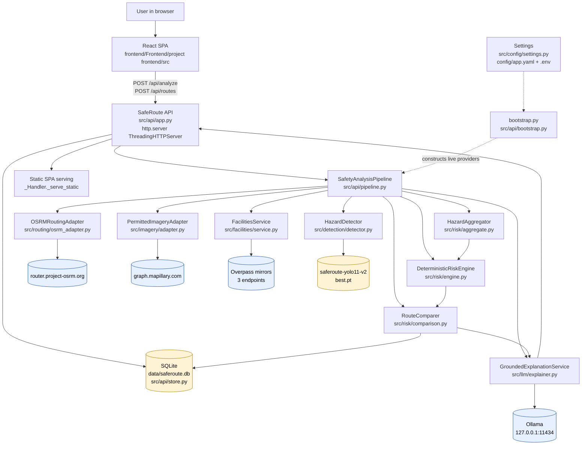
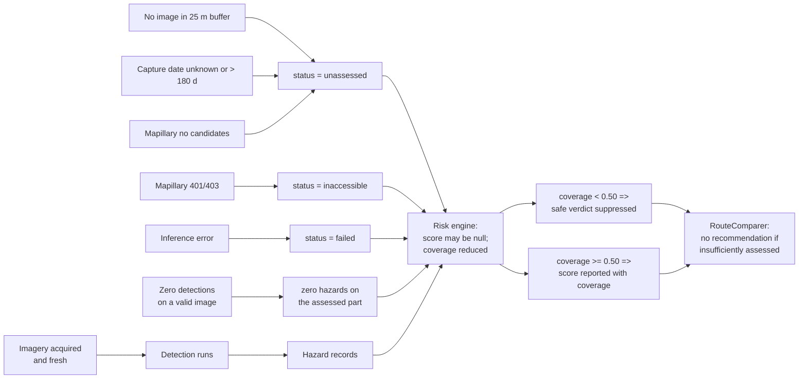
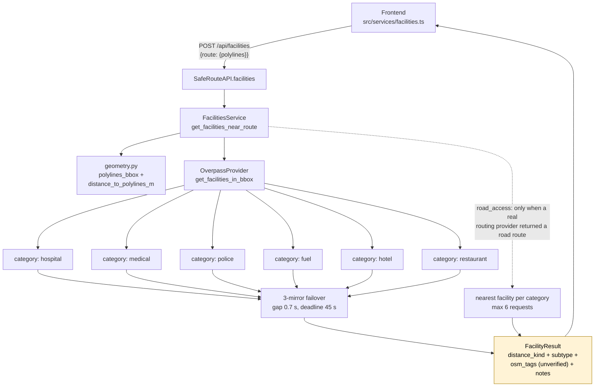
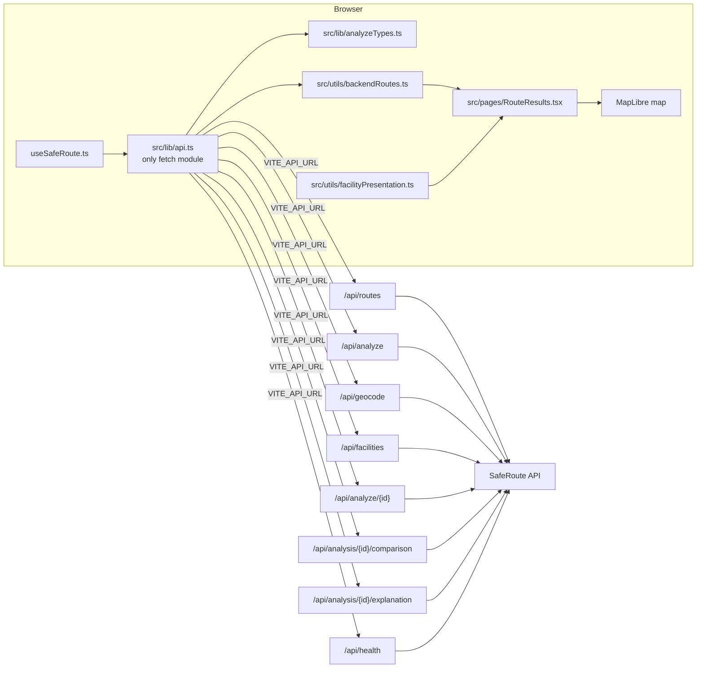
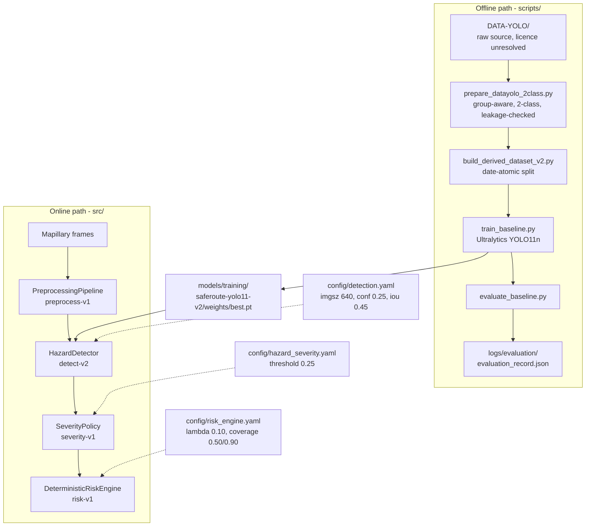
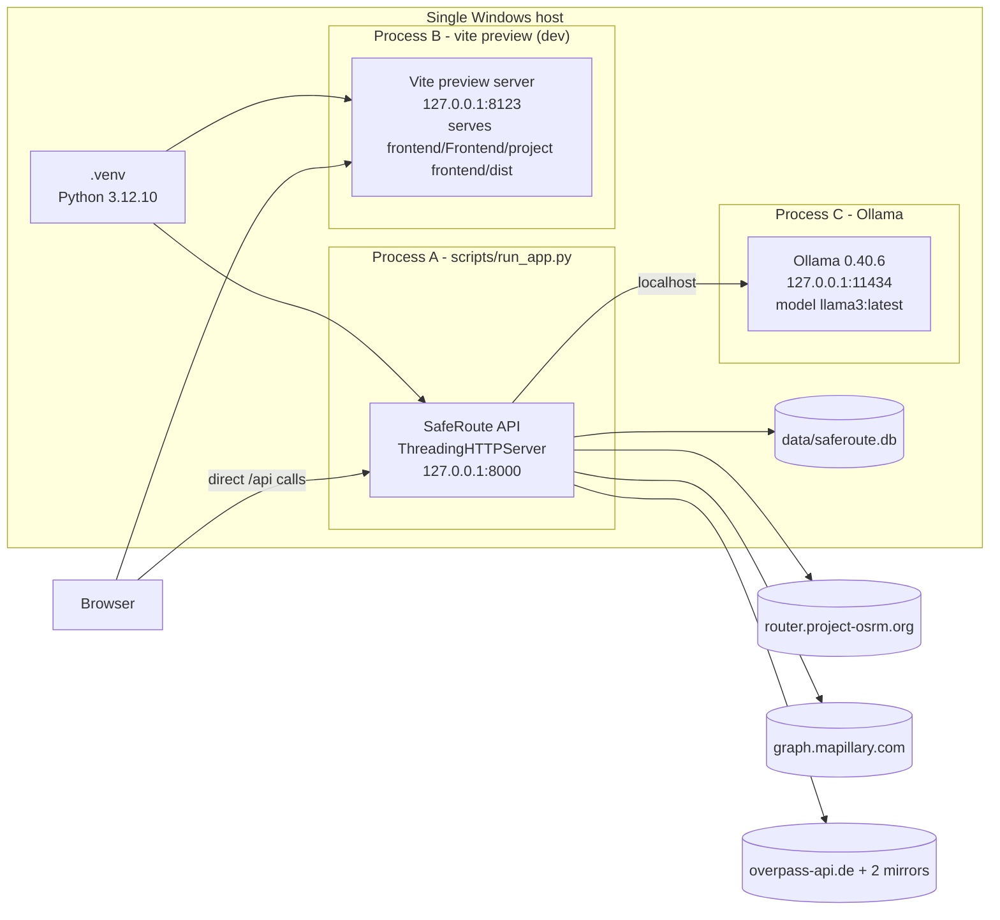
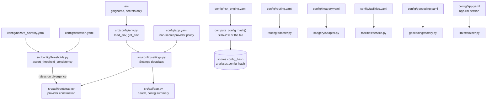
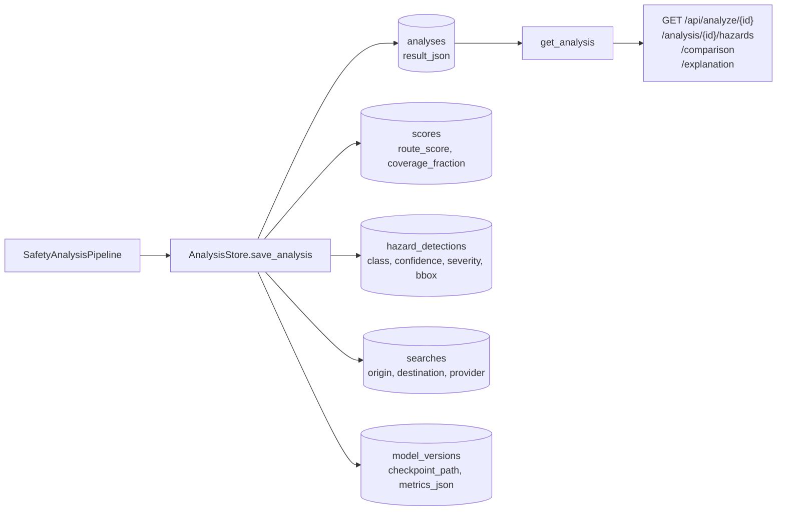

# 02 — Architecture and Data Flow

> **Workspace:** `D:\New folder (3)` · **Audit date:** 2026-10-21 · **Read-only analysis**
> **Related:** [`00-executive-summary.md`](00-executive-summary.md) ·
> [`01-repository-map.md`](01-repository-map.md) ·
> [`07-api-database-and-integrations.md`](07-api-database-and-integrations.md)

Every diagram below reflects the **actual implementation**. Node labels quote the real
module, class or function that performs the step. Where the implemented architecture
differs from `docs/ARCHITECTURE.md`, the implemented behaviour is shown and the divergence
is recorded as Finding **F-02**.

---

## 1. Architectural principles actually enforced in code

| Principle | Rule | Enforcement point |
|---|---|---|
| The backend is the **sole** owner of safety scores | 7 | `src/risk/engine.py` `DeterministicRiskEngine`; the frontend contains no score computation on any live path (`src/utils/safety.ts` is dead — F-07). |
| The LLM may only **explain** verified results | 12 | `src/llm/explainer.py` `GroundedExplanationService`; the prompt carries only verified backend records, and the reply is schema-validated and entity-grounded before use. |
| Facilities are **context only** | 11 | `config/facilities.yaml` `guardrails.facilities_in_hazard_score: false`; `src/facilities/schemas.py` has no score/risk field; `src/risk/*` never imports `src/facilities/*`. |
| Missing evidence is **unassessed**, never "safe" | 9 | `src/risk/engine.py` coverage suppression + `unassessed_score_placeholder: null` in `config/risk_engine.yaml`; `src/imagery/staleness.py` treats an unknown capture time as stale. |
| Only routes the provider **actually returned** are shown | 10 | `config/routing.yaml` `guardrails.enforce_rule_10: true`; `MockRoutingAdapter` marks synthetic routes as demo. |
| Only **permitted** imagery | 8 | `config/imagery.yaml` `sources` registry; `google_street_view` is explicitly `enabled: false` with a ToS reason. |
| Everything stays **inside the workspace** | 1 | `src/config/env.py` `WORKSPACE_ROOT`; `src/api/app.py` `_serve_static` resolves and rejects paths outside the static root. |

## 2. System context — component architecture



**Note on the facilities path.** `FacilitiesService` is reached from the API's
`POST /api/facilities` handler and is **not** part of the analysis pipeline's scoring
path. The arrow `PIPE --> FAC` in the diagram reflects that `SafetyAnalysisPipeline`
holds a facilities handle for the corridor lookup; it does **not** feed the risk engine —
see §4.

## 3. Backend module dependency graph

Arrows point from importer to imported module. Derived from the `import` statements in
`src/**`.

```mermaid
graph TD
    api_app["api/app.py"] --> api_pipeline["api/pipeline.py"]
    api_app --> api_store["api/store.py"]
    api_app --> cfg_settings["src/config/settings.py"]
    api_app --> src_config["src/config/__init__.py"]

    api_pipeline --> cfg_thresholds["src/config/thresholds.py"]
    api_pipeline --> fac_service["facilities/service.py"]
    api_pipeline --> img_adapter["imagery/adapter.py"]
    api_pipeline --> llm_explainer["llm/explainer.py"]
    api_pipeline --> risk_aggregate["risk/aggregate.py"]
    api_pipeline --> risk_comparison["risk/comparison.py"]
    api_pipeline --> risk_engine["risk/engine.py"]
    api_pipeline --> risk_schemas["risk/schemas.py"]
    api_pipeline --> routing_adapter["routing/adapter.py"]

    api_bootstrap["api/bootstrap.py"] --> api_pipeline
    api_bootstrap --> fac_service
    api_bootstrap --> geo_factory["geocoding/factory.py"]
    api_bootstrap --> img_adapter
    api_bootstrap --> img_mapillary["imagery/mapillary_provider.py"]
    api_bootstrap --> llm_explainer

    fac_service --> fac_geometry["facilities/geometry.py"]
    fac_service --> fac_interfaces["facilities/interfaces.py"]
    fac_service --> fac_overpass["facilities/overpass_provider.py"]
    fac_service --> fac_mock["facilities/mock_provider.py"]
    fac_service --> fac_schemas["facilities/schemas.py"]

    img_adapter --> img_matcher["imagery/matcher.py"]
    img_adapter --> img_staleness["imagery/staleness.py"]
    img_adapter --> img_schemas["imagery/schemas.py"]
    img_mapillary --> img_schemas

    det_detector["detection/detector.py"] --> pre_pipeline["preprocessing/pipeline.py"]
    det_detector --> det_schemas["detection/schemas.py"]

    risk_engine --> risk_aggregate
    risk_engine --> risk_schemas
    risk_aggregate --> risk_severity["risk/severity.py"]
    risk_aggregate --> det_schemas
    risk_comparison --> risk_schemas

    routing_adapter --> routing_osrm["routing/osrm_adapter.py"]
    routing_adapter --> routing_mock["routing/mock_adapter.py"]
    routing_adapter --> routing_seg["routing/segmentation.py"]
    routing_osrm --> routing_seg
    routing_osrm --> routing_schemas["routing/schemas.py"]

    img_matcher --> routing_seg
    img_matcher --> routing_schemas

    classDef warn fill:#ffe9b3,stroke:#a67c00,color:#000
    class risk_engine,llm_explainer warn
```



Two properties of this graph matter for Rule 7 and Rule 11:

1. **No path from `src/facilities/**` into `src/risk/**`.** The facilities package is
   imported by `api/pipeline.py` and `api/bootstrap.py` only. The risk engine cannot see
   a facility even by accident.
2. **No path from `src/llm/**` into `src/risk/**` or `src/detection/**`.** The LLM
   package depends on nothing upstream; it consumes already-computed results. The
   dependency arrow points *into* the explainer, not out of it.

## 4. Analysis data flow — one `POST /api/analyze`

```mermaid
sequenceDiagram
    autonumber
    participant FE as Frontend<br/>useSafeRoute.ts
    participant API as SafeRouteAPI.analyze
    participant PIPE as SafetyAnalysisPipeline
    participant RT as OSRMRoutingAdapter
    participant IMG as PermittedImageryAdapter
    participant DET as HazardDetector
    participant AGG as HazardAggregator
    participant RISK as DeterministicRiskEngine
    participant CMP as RouteComparer
    participant LLM as GroundedExplanationService
    participant ST as AnalysisStore

    FE->>API: POST /api/analyze {origin, destination, route_ids?}
    API->>PIPE: analyse(request)
    PIPE->>RT: get_routes(origin, destination, alternatives=true)
    RT-->>PIPE: RouteResponse(routes actually returned)
    Note over RT: Rule 10 - routes are never padded or synthesised
    RT->>RT: RouteSegmenter.segment(<br/>target 200 m, 50-500 m bounds)

    par Parallel imagery prefetch across segments
        PIPE->>IMG: get_imagery(segment)
        IMG->>IMG: SegmentImageryMatcher<br/>(25 m buffer)
        IMG->>IMG: StalenessEvaluator<br/>(180 days; unknown=stale)
        IMG-->>PIPE: ImageryResult(images | unavailable)
    end

    PIPE->>DET: detect(image)
    DET->>DET: PreprocessingPipeline<br/>validate - letterbox - prepare
    DET->>DET: YOLO11 predict<br/>conf 0.25, iou 0.45, imgsz 640
    DET-->>PIPE: ImageDetectionResult(detections)
    PIPE->>AGG: assess_segment(segment, detections)
    AGG->>AGG: SeverityPolicy<br/>dedup IoU 0.45
    AGG-->>PIPE: HazardRecord list
    PIPE->>RISK: score_route(segments, hazards)
    RISK->>RISK: H = severity per km<br/>S = 100 * exp(-0.10 * H)
    RISK->>RISK: coverage suppression<br/>min 0.50, full 0.90
    RISK-->>PIPE: RouteSafetyResult[]
    PIPE->>CMP: RouteComparer.build(results)
    CMP-->>PIPE: ranking + recommendation<br/>(null when evidence insufficient)
    PIPE->>LLM: explain(verified results only)
    LLM-->>PIPE: ExplanationResult<br/>(source ollama or fallback)
    PIPE->>ST: save_analysis(...)
    PIPE-->>API: analysis record
    API-->>FE: 200 {analysis_id, routes, comparison,<br/>recommendation, explanation}
```

### 4.1 The two honest-failure branches



The critical distinction, implemented in `src/risk/engine.py` and asserted by
`tests/unit/test_risk_engine.py` and `tests/unit/test_route_recommendation_correctness.py`:
**"zero detections on an image we successfully assessed"** and **"no image, therefore
unassessed"** produce different statuses and different coverage figures. Only the first
may contribute a low hazard value.

## 5. Facilities flow — a separate request path (Rule 11)



Note the deliberate absence of any arrow from `RES` into the risk engine or the route
comparison. The facilities response is returned to the UI as a separate panel.

## 6. Frontend ↔ backend contract



The frontend performs **no** third-party network calls of its own. In particular, after
the Phase 2 change, the browser no longer queries Overpass directly — `POST /api/facilities`
is the single source of truth for facilities.

### 6.1 Client-side timeouts

Configured in `src/lib/api.ts` from `VITE_ANALYZE_TIMEOUT_MS` and defaults read from
the same module:

| Call | Timeout (ms) |
|---|---:|
| `/api/analyze` | 900 000 (15 min) |
| `/api/routes` | 60 000 |
| `/api/facilities` | 90 000 |
| `/api/geocode` | 60 000 |

Error kinds surfaced by `ApiError`: `network`, `timeout`, `http`, `invalid`, `aborted`.

## 7. ML pipeline — training (offline) versus serving (online)



The inference path shares the same `PreprocessingPipeline` module used for validation and
visualisation, satisfying Rule 6's "consistent, documented preprocessing" requirement.
The training path uses Ultralytics' own augmentation pipeline; this is a **documented
divergence**, not an unnoticed one, and is discussed in
[`05-preprocessing-and-feature-engineering.md`](05-preprocessing-and-feature-engineering.md) §5.

## 8. Runtime and deployment topology (as implemented)



In the documented single-command mode (`scripts/run_app.py`), the API process also serves
the prebuilt `frontend/` directory, so one process covers API + UI. The two-process split
above is the configuration used for the Phase 2 browser verification (Vite preview on
8123, API on 8000).

## 9. State and configuration flow



`Settings.to_safe_dict()` is the only method that exposes configuration outward, and it
**never emits secrets** — `/api/config` returns a capability summary only.

## 10. Persistence flow



`save_analysis` is idempotent for `analyses`, `searches` and `scores`
(`INSERT OR REPLACE`), and explicitly deletes prior `hazard_detections` rows for the
analysis before re-inserting, so repeated saves do not duplicate detections.

---

*Diagram source: the `src/**` import graph, the `src/api/app.py` handler dispatch table,
`src/api/pipeline.py` orchestration order, `src/api/store.py` `_SCHEMA`, and the frontend
`src/lib/api.ts` call sites. Every function name quoted above exists in the repository at
the paths shown.*
