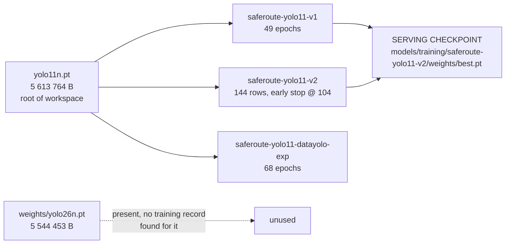

# 06 — ML Models and Algorithms

> **Workspace:** `D:\New folder (3)` · **Audit date:** 2026-10-21
> **Evidence policy:** every metric below is **repo-reported** unless explicitly marked
> *measured*. The models were **not** re-trained or re-evaluated during this audit, and
> no metric was independently reproduced.
> **Related:** [`04-dataset-and-labeling.md`](04-dataset-and-labeling.md) ·
> [`05-preprocessing-and-feature-engineering.md`](05-preprocessing-and-feature-engineering.md) ·
> [`14-findings-and-recommendations.md`](14-findings-and-recommendations.md)

---

## 1. Algorithm selection

| Stage | Algorithm | Implementation | Rule |
|---|---|---|---|
| Road-hazard detection | **Ultralytics YOLO11n** (single-shot object detector) | `src/detection/detector.py` via `ultralytics` 8.4.163 | 4 — YOLO11 is mandated |
| Image processing | **OpenCV** validation + letterbox | `src/preprocessing/pipeline.py` via `opencv-python` 4.14.0.94 | 6 |
| Severity assignment | **Deterministic config-driven policy** | `src/risk/severity.py` | 5, 7, 12 |
| Hazard aggregation | **IoU-based NMS + adjacent-segment dedup** | `src/risk/aggregate.py` | 5, 7 |
| Risk scoring | **Exponential decay**: `S_i = 100·exp(−λ·H_i)` | `src/risk/engine.py` | 7 |
| Route comparison | **Deterministic policy** with explicit refusal conditions | `src/risk/comparison.py` | 7, 9, 14 |
| Explanation | **Local LLM** (Ollama, `llama3:latest`) with schema validation + entity grounding | `src/llm/explainer.py` | 12 |

**No classical ML (scikit-learn, XGBoost, k-means) is used anywhere.** The project uses
exactly one learned model — the YOLO11 detector — and every downstream quantity is a
deterministic function of its output. This is the direct implementation of Rule 7.

## 2. Model lineage



| Model | Epochs | `best.pt` SHA-256 | Status |
|---|---:|---|---|
| `saferoute-yolo11-v1` | 49 | `61F6EDA2B7ABBF12B87355B1E0871F4B9F0435C3D68762AF89C5349908078E65` | Baseline; metrics recorded in `logs/evaluation/evaluation_record.json` |
| `saferoute-yolo11-v2` | 144 rows, early stop at **104** | `B6354A562FDAF4B0A1498FDE2976930A94EAC8184083D0DD30342205DF8800BA` | **Serving checkpoint** (`config/detection.yaml` → `model.checkpoint`) |
| `saferoute-yolo11-datayolo-exp` | 68 | `730CE43974AF67BB228704C981D55D0FF8879FC42A4C75DF646ABE289FD590BB` | Experimental; trained on the DATA-YOLO preparation output. Provenance record stale — F-04 |
| `yolo11n.pt` (root) | — | — | Base pretrained weights |
| `weights/yolo26n.pt` | — | — | Additional weights; **no training record found** for it in the repository |

`runs/detect/` is empty — no stray Ultralytics run directories are lying around.

## 3. The serving checkpoint

`config/detection.yaml`:

```yaml
metadata:
  version: "detect-v2"
  model_version: "saferoute-yolo11-v2"

model:
  checkpoint: "models/training/saferoute-yolo11-v2/weights/best.pt"

inference:
  imgsz: 640
  conf: 0.25
  iou: 0.45
  max_det: 300
  augment: false
  batch: 1
  device: null

supported_classes:
  0: pothole
  1: crack
```

The comment above the checkpoint records the promotion decision:

> PHASE_24G: serving checkpoint promoted to v2 (per PHASE_24F recommendation, 601-image
> unseen micro F1 0.297 -> 0.327 at conf 0.25). Confidence and all other inference
> settings are intentionally unchanged.

**Important caveat.** That 0.297 → 0.327 figure is a **micro-F1 on a 601-image unseen
micro set**, computed on a single micro-averaged metric at a single confidence
threshold. It is *not* comparable to the mAP50 figures in §4, which come from a
different evaluation record and a different checkpoint. The two must never be quoted
side by side as if they were the same measurement.

`/api/health` reports the loaded model version as **`saferoute-yolo11-v2`** — verified
against the live server during the Phase 2 verification.

## 4. Repo-reported evaluation metrics

**Source:** `logs/evaluation/evaluation_record.json` — checkpoint `saferoute-yolo11-v1`.
**Status: repo-reported. Not independently reproduced during this audit.**

### 4.1 Validation split

| Metric | Value |
|---|---:|
| Precision | 0.3937 |
| Recall | 0.3110 |
| F1 | 0.3475 |
| **mAP50** | **0.2731** |
| mAP50–95 | 0.1007 |

### 4.2 Test split

| Metric | Value |
|---|---:|
| Precision | 0.3383 |
| Recall | 0.3009 |
| F1 | 0.3185 |
| **mAP50** | **0.2615** |
| mAP50–95 | 0.0952 |

### 4.3 Per-class mAP50

| Class | Validation | Test |
|---|---:|---:|
| `pothole` | 0.3277 | 0.2909 |
| `crack` | 0.2185 | 0.2321 |

### 4.4 Other recorded values

| Quantity | Value | Status |
|---|---:|---|
| Inference latency | 4.02 ms/image | repo-reported |
| Decision | `ACCEPT` / `APPROVED_BASELINE_SERVING` | repo-reported |
| Model version reported by `/api/health` | `saferoute-yolo11-v2` | **measured** (live server) |

### 4.5 Internal inconsistency — F-03

The `rationale` prose in `evaluation_record.json` quotes **mAP 0.278 / 0.231** while the
machine-readable fields in the same file record **mAP50 0.2731 / 0.2615**. These are
different numbers for the same quantities. One of the two is wrong; the file does not say
which. Until it is reconciled, only the structured fields should be quoted, and the
discrepancy should be disclosed.

## 5. Honest reading of these numbers

**mAP50 ≈ 0.27 means the detector is weak.** For context, a random-detector baseline on
a two-class task lands far lower, so the model has learned *something*; but mAP50 of 0.27
means that for roughly three out of four true hazards, the detector does not produce a
correct, confident, correctly-localised detection.

The practical consequences that follow, and which the project already handles honestly:

1. **Recall is the weak axis** (0.31 validation). Missing detections are common, so a
   low hazard count on a segment is weak evidence, not strong evidence.
2. **The risk engine therefore leans on coverage, not on hazard counts.** A route scored
   safe must also be *sufficiently assessed*, and the score is always published with its
   coverage fraction.
3. **The comparison layer refuses to recommend** when assessed length is insufficient,
   when imagery is stale or demo, or when top scores tie. Weak detection plus honest
   refusal is a coherent system; weak detection plus confident recommendations would not
   be.
4. **The score is ordinal.** It is a deterministic, reproducible ordering of routes under
   a fixed policy — not a calibrated probability of encountering a hazard.

**This must be stated in any presentation.** Quoting "AI road-safety detection" without
the measured mAP50 would misrepresent the system (Rule 14, Rule 20).

## 6. Training configuration

From `models/training/*/args.yaml` and `scripts/train_baseline.py`:

| Parameter | Value | Note |
|---|---|---|
| Architecture | YOLO11n | Baseline-first, per TRD §5.1 |
| Input size | 640 | Matches `config/detection.yaml` `imgsz` |
| Batch size | small (VRAM-constrained) | `docs/TRD.md` §17 documents the 8 GB VRAM constraint |
| Epochs | v1: 49 · v2: 144 rows with early stop at 104 · datayolo-exp: 68 | |
| Early stopping | Enabled for v2 (patience-based) | TRD §5.5 |
| Mixed precision (AMP) | Enabled where supported | TRD §5.4 |
| Workers | 2 for the datayolo-exp run (this is the value that triggered the recorded DataLoader crash, F-04) | |
| Seeds | Recorded per run in `args.yaml` | TRD §5.4 / Rule 17 |
| Device | CUDA when available, CPU otherwise | `config/detection.yaml` `device: null` |
| Checkpoints | `best.pt` and `last.pt` under `models/training/<version>/weights/` | TRD §5.4 |
| Output | `results.csv`, `results.png`, `args.yaml`, `train.log` | |

## 7. Evaluation methodology

`scripts/evaluate_baseline.py` (319 lines) produces `evaluation_record.json`. It
evaluates precision, recall, F1, mAP50 and mAP50–95, per-class breakdowns, and writes a
decision with a rationale.

**Methodological notes that must accompany any published number:**

- The v1 record evaluates the **v1** checkpoint; the **v2** checkpoint is what actually
  serves traffic. The published mAP50 of 0.2731 is therefore *not* a measurement of the
  serving model.
- **The effective evaluation set was smaller than the split file suggests.** F-37:
  `config/training_canonical.yaml` records that Ultralytics discards any image whose
  label contains a class ≥ `nc`, so the v1 and v2 runs actually used **861 of 1 406**
  train, **264 of 402** validation and **125 of 201** test images. The v1 metrics in
  `logs/evaluation/evaluation_record.json` were measured on that reduced set.
- The v2 promotion evidence is a 601-image micro-F1 on an unseen micro set — a
  different metric on a different data slice.
- **Neither figure is an independent holdout** in the strict sense. The v1 evaluation
  used the `data/dataset.yaml` split (train 1 406 / val 402 / test 201); the `datayolo_prep`
  `test:` split is explicitly documented as a same-source, scene-grouped list (F-15).

**Recommended:** re-evaluate the **serving** v2 checkpoint on the **date-atomic**
`data/splits_v2` test split (216 images, capture date 2025-02-26) and record the result
as a single, unambiguous, auditable figure. That closes F-13, F-15, F-37 and part of
F-03 at once, and it is the single highest-value measurement the project can make next.

## 8. The LLM as an algorithm boundary

`src/llm/explainer.py` (818 lines) is the largest single backend module, and it is worth
being precise about what it does and does not do.

### 8.1 What it receives

Only **verified backend results**: per-route scores, coverage fractions, the bounded
representative sample of verified hazards (with the exact total counts `hazards_total` /
`hazards_by_class` alongside), and the explicit limitations list.

### 8.2 What it validates

1. **Output contract.** `SYSTEM_PROMPT` states the required fields: `explanation`,
   `referenced_routes`, `referenced_hazards`, `disclosures`, `source`.
2. **Entity grounding.** Any route or hazard identifier referenced in the reply that was
   not present in the backend input is **rejected**. The reply is discarded, not patched.
3. **Injection resistance.** User text and imagery-derived text are treated as data, never
   as instructions. The LLM has no tool access and cannot mutate state.

### 8.3 The PHASE_28 repair (documented in `src/llm/explainer.py`)

The prompt previously carried **every** verified hazard of **every** route. A long route
(4 routes × ~110 segments × 2 detections) produced a ~140 KB prompt; the local model then
continued the data as if it were more JSON (`{"hazard_segments": [...]}`), the grounding
check correctly rejected the reply, and the service silently degraded to
`source="fallback"` for **every** live request.

The fix (Phase 28): the prompt now carries a **bounded, representative subset** of the
verified hazards per route together with the **exact total counts**, and the prompt text
states that the sample is not the complete set (Rules 9, 20).

### 8.4 The deterministic fallback

If Ollama is unreachable, times out, returns malformed output, or produces an
ungrounded reply, `_fallback()` produces a template explanation built **only** from
verified backend data. The response carries `source: "fallback"` so the UI can mark it
as such. This satisfies TRD §13.4: the product degrades gracefully rather than
silently.

**Design assessment:** the LLM layer is well-built. Its size is justified — the
grounding, validation and fallback logic is genuinely intricate — but the *phase-28
incident* is instructive: the failure was silent (`source="fallback"` on every request),
which is exactly the kind of degradation that Rule 20 exists to prevent. A metric or
log line counting fallback usage would have surfaced it immediately.

## 9. Algorithm risk register

| ID | Risk | Severity | Mitigation |
|---|---|---|---|
| F-13 | Detection accuracy is weak (mAP50 ≈ 0.26–0.27) | High | Present the numbers honestly; strengthen the coverage-based refusal policy; retrain on a licensed, larger corpus |
| F-03 | Evaluation record is internally inconsistent | Medium | Reconcile the prose against the fields |
| F-15 | Published evaluation used a non-independent holdout | Medium | Re-evaluate on `data/splits_v2` test |
| F-04 | `datayolo-exp` provenance record under-reports a successful run | Medium | Regenerate `run_record.json` from `results.csv` |
| F-08 | Licence of the training corpus unresolved → weights may be unusable/redistributable | High | Resolve or re-train on a licensed corpus |
| F-14 | 49 intra-split duplicate groups inflate the effective training size | Medium | Deduplicate and retrain |
| F-37 | v1/v2 trained and evaluated on a silently reduced image set (861/1 406, 264/402, 125/201) | Medium | Publish the actual counts; add a loaded-image-count assertion to the training scripts |
| — | `weights/yolo26n.pt` has no training record | Low | Either train from it and record the run, or remove it |
| — | The published metric is for v1 while v2 serves traffic | Medium | Re-evaluate the serving checkpoint |

## 10. What "the model" means in this project

A precise answer matters for the viva and for the presentation:

> SafeRoute AI has **one** learned model — a YOLO11n object detector for two classes
> (pothole, crack). Everything the user sees as a "safety score" is a **deterministic
> function** of that detector's output, the road imagery coverage, and the image's
> freshness. The language model contributes prose only; it never touches a number, a
> ranking, or a recommendation. The system's most important output is frequently the
> decision **not** to recommend a route.

---

*Metrics in §4 are quoted verbatim from `logs/evaluation/evaluation_record.json` and are
labelled repo-reported throughout. The v2 promotion figure in §3 is quoted from the
comment in `config/detection.yaml`. No training or evaluation was executed during this
audit.*
